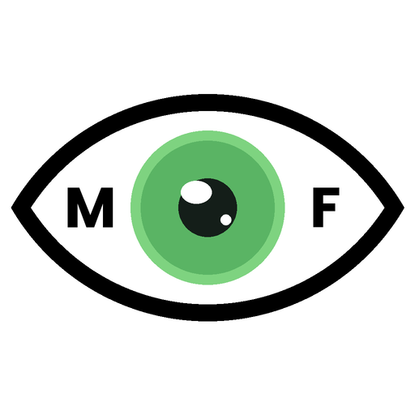

<p align="center">
  
</p>

<h1 align="center">MeigFACE</h1>

<p align="center"><strong>Eye contact training with a local AI avatar.</strong></p>

<p align="center">
  
  
  
  
  
</p>

<p align="center">
  
  
  
</p>

<p align="center">
  <a href="https://github.com/GiulioMagini/MeigFACE/releases"></a>&nbsp;<a href="https://github.com/GiulioMagini/MeigFACE/stargazers"></a>
</p>

<p align="center">
  <a href="https://github.com/GiulioMagini/MeigFACE/releases/latest/download/MeigFACE.Windows.7z"></a>&nbsp;<a href="https://youtu.be/iKb0n9unKlg"></a>
</p>

<p align="center">
  <a href="https://giuliomagini.com/video/MeigFACE.mp4">
    
  </a>
</p>

MeigFACE is a local desktop application for eye-contact training using a 2D avatar. The avatar has a conversation with the user, while the program controls his eye-tracking to ensure that the user speaks and listen to the avatar while looking at it. This application was created for:
- **Adults** who want to be more confident in speaking (for example, sales staff who need to speak with clients very frequently and want to improve in this specific area)
- **Kids** who have problems talking to people due to shyness or issues with sensory over-sensitivity (such as in individuals on the autism spectrum). The avatar acts as an intermediary to speaking with a real person; consequently, many children find it much easier to interact with an avatar first, and then apply the training (or masking) when dealing with real people.

The application can be used also for other types of training, because the system prompt (the initial prompt upon which the entire discussion with the chosen LLM is based) is completely free and customizable. Some examples:
- Foreign language practice
- Oral exams and oral assessments
- Specific work scenarios (e.g., a customer complaint)
- Help with diction exercises and stuttering

**IMPORTANT**: <mark style="background-color: gold;">**The author is not responsible for the content a model generates**, including inappropriate or harmful output, and that includes output directed at children or any other person.</mark>

---

**Tested on:** Windows 11, Linux (Debian 13)

**Tested PCs**: a 2024 PC with 16 GB of VRAM (main development machine), a 2016 PC with a 980M graphics card (8 GB of VRAM), and a 2018 PC with an AMD Radeon graphics card (2 GB of VRAM) running Linux (Debian 13).

**Not tested on:** macOS. The application is expected to need changes to its bundle configuration before it runs there. Furthermore, this program uses the older version of Piper (the 2023 MIT repository) for speech synthesis, because the new version only works with Python; while Windows and Linux run their respective versions without issues, Macs have transitioned from x86_64 to ARM architecture, thus requiring either "Rosetta" to run the file or a direct compilation of the old project for the new Macs.

**Interface and conversation languages:** Italian, English, French, German, Spanish, Portuguese, plus any language you add yourself (to add a language see [DETAILS.md](DETAILS.md)).

**Requires:** a webcam, a microphone, and a GPU with at least 3 GB of VRAM (2 GB for English only) or a machine with DDR5 memory. See [DETAILS.md](DETAILS.md).

---

## 💻 How a full session works

1. **Calibrate once.** You look at eight targets, four on the screen corners and four on the avatar's eyes, for about a minute. The result is saved and reused. To improve calibration, see [DETAILS.md](DETAILS.md).
2. **Choose the settings.** Avatar, voice, how long to wait before the avatar replies, how long it should listen. These can be saved as a named profile.
3. **Talk.** Pick a length between one and four minutes and start. The avatar listens, answers, and your eye contact is measured continuously while it does.
4. **Read the result.** Contact percentage, longest streak, breaks and trend, next to your historical average across all sessions of that profile. The program also saves the topics discussed during the session to a local database, along with the results, which can then be viewed and edited within the program.

This entire process takes place **locally**: everything runs on the user's PC without relying on external factors. Naturally, the better the computer used, the higher the program's performance. For more information on this, please check [DETAILS.md](DETAILS.md).

---

## 🔧 Installing the runtime components

MeigFACE ships no model and no inference engine. Before the first session you need five things on disk: `llama-server`, a GGUF conversation model, `whisper-server`, a Whisper model, and Piper with at least one voice.

**On Windows**, run the included PowerShell script (extract the 7z file, the executable and the ps1 file must be in the same folder) and it does all of it:

```powershell
powershell -ExecutionPolicy Bypass -File .\MeigFACE-setup.ps1
```

It reads your Windows display language, detects your hardware, downloads the right models for it and writes the paths into the application settings. It covers the six built-in languages and NVIDIA cards.

**Everywhere else**, or when you want to choose your own models, the setup is manual (including the build of whisper.cpp executable for Linux) and [DETAILS.md](DETAILS.md) walks through it component by component.

---

## ⚙️ How it works at runtime

The application uses Tauri, an open-source framework for building desktop and mobile software applications using web technologies. Tauri acts as an orchestrator, managing the necessary executables and ensuring they run in the required sequence. The program utilizes:
- **llama.cpp**: The most well-known application for running small, local AI systems on standard computers. It powers the AI ​​system that interacts with the user. **SmolLLM** was selected as the default LLM; this 3-billion-parameter model is capable of effectively conversing in the program's six primary European languages ​​(English, Italian, French, Spanish, German, and Portuguese). However, users can choose any other LLM from HuggingFace (or other sites) that supports their language. 
**NOTE: When using an LLM with "thinking" capabilities, this feature is disabled by default due to excessive latency (adding 7 to 10 seconds to a standard conversation).** While performance is lower, the model remains sufficient for a sustained conversation, unless the 0.8B model is used.
- **whisper.cpp**: The leading application for running custom AI models for speech recognition and speech-to-text translation. The specific model used depends on the desired level of accuracy (tiny, small, medium, or large) and runs in the computer's RAM or VRAM alongside the selected LLM.
- **piper**: One of the world's most popular text-to-speech programs. It uses synthetic voice models (ONNX files) to "speak" to the user. While there are far more advanced AI-based text-to-speech models available (including open-source options like Qwen3tts), Piper is unique in combining support for major languages ​​with the ability to run entirely on the CPU rather than the GPU; this offloads the task from the GPU, allowing the entire system to run even on less powerful PCs. Additionally, Piper supports the training of custom voices using recordings made by the user or generated by other AI models (such as the aforementioned Qwen3TTS). Using this technique, I created a synthetic voice based on my own to keep locally for testing purposes; there are more details about this at the end of the README.

The operating cycle is as follows:
- The user speaks to the avatar displayed in the center of the screen.
- whisper.cpp, running alongside its binary model, recognizes the speech and converts it into text. Some transcription errors may occur here, more frequently if the binary model used is for a language other than English or is a "tiny" model.
- The text is sent as input to the LLM, which runs using llama.cpp.
- The LLM processes the text and generates a response.
- The response is sent to Piper, which generates audio using its "onnx" voice.
- The audio is used to animate the avatar's mouth, based on the frequency of the generated audio (and user-defined settings).
- The system waits for the user to speak again.

This process repeats until the set time (1 to 4 minutes) elapses. The dialogue between the user and the AI ​​is displayed on the right, while the scores are on the left (as shown in the video above).

---

## 📡 Complete features

- Real-time gaze tracking from any webcam, with per-user calibration
- Conversation with a local LLM: it listens, transcribes, answers and speaks
- 2D avatar with lip sync driven by the generated audio and configurable head movement
- Eye contact scoring: percentage of contact, longest streak, number of breaks, live trend
- Blink-tolerant detection, so a blink never costs you points
- Session history with per-user profiles, stored locally in SQLite
- Automatic topic summaries: the avatar recalls what you talked about in the last two sessions
- Editable system prompt, saved prompts and saved parameter profiles
- Six built-in interface and conversation languages, extensible to any other
- Automatic Windows installer for all runtime components
- Fully offline after setup: no account, no server, no telemetry

---

## 🚧 Installing and loading the entire project

```bash
npm install
# Start the local development environment of a Tauri application
npm run tauri dev
# Build the application
npm run tauri build
```

---

## 🧱 Tech stack

| Component | Technology |
| --- | --- |
| Application shell | Tauri 2 (Rust 2024 edition) |
| Frontend | Svelte 5 (SvelteKit, static adapter) + TypeScript |
| Database | SQLite via rusqlite (bundled, WAL) |
| Face and gaze tracking | MediaPipe Tasks Vision (FaceLandmarker, in-browser) |
| Avatar | Hand-written SVG, animated from tracking and audio |
| Conversation engine | llama.cpp (`llama-server`), installed by the user |
| Speech recognition | whisper.cpp (`whisper-server`), installed by the user |
| Speech synthesis | Piper, installed by the user |
| Networking | reqwest, restricted to localhost |

---

## 📜 Legal notes

MeigFACE is a practice tool, not a medical device and not a substitute for therapy. It does not diagnose anything and it makes no clinical claim. The program does not in any way replace the qualified opinion of a doctor or specialist.

The user have the power to choose the LLM used and to edit the prompt, which is fully customizable. Therefore the author is not responsible for the content a model generates, including inappropriate or harmful output, and that includes output directed at children or any other person. Running an uncensored model, or writing a prompt that steers one, is the user's prerogative and is therefore their sole responsibility.

The models and the voices are downloaded from their official sources onto the user machine and are not redistributed by this project. Each carries its own licence: see the Credits section, and read the `MODEL_CARD` of any voice before using it beyond personal use.

---

## 📄 License

MIT License

Copyright (c) 2026 Giulio Magini

See [LICENSE](LICENSE) for the full license text.

All Rust and npm dependencies use permissive open-source licenses (MIT, Apache 2.0, BSD) compatible with this project's MIT license. Their licenses ship with their respective packages and are available when building the project.

The inference engines, the language models and the voices are **not** part of this repository and are **not** redistributed by it. They are downloaded from their official sources onto your own machine, and each one carries its own license. The next section lists them.

---

## 🙏🏻 Credits

### Frameworks and libraries

- [Tauri](https://tauri.app/) - desktop application shell
- [SvelteKit](https://kit.svelte.dev/) - frontend framework
- [rusqlite](https://crates.io/crates/rusqlite) - SQLite bindings, bundled build
- [reqwest](https://crates.io/crates/reqwest) - HTTP client for the local engines
- [MediaPipe Tasks Vision](https://developers.google.com/mediapipe) - face landmarks and iris tracking

### Inference engines

- [llama.cpp](https://github.com/ggml-org/llama.cpp) - MIT - runs the conversation model
- [whisper.cpp](https://github.com/ggml-org/whisper.cpp) - MIT - runs speech recognition
- [Piper](https://github.com/rhasspy/piper) - MIT - speech synthesis
- CUDA runtime redistributables - NVIDIA EULA - required by the CUDA builds of the two engines above

### Language models

These are the models the setup script installs, depending on the hardware it finds. Quantised builds are redistributions of the models below.

| Model | Author | License |
| --- | --- | --- |
| [SmolLM3-3B](https://huggingface.co/HuggingFaceTB/SmolLM3-3B) | Hugging Face | Apache 2.0 |
| [Qwen3-1.7B](https://huggingface.co/Qwen/Qwen3-1.7B) | Alibaba Cloud | Apache 2.0 |
| [Qwen3.5-0.8B](https://huggingface.co/Qwen/Qwen3.5-0.8B) | Alibaba Cloud | Apache 2.0 |
| [Whisper (ggml builds)](https://huggingface.co/ggerganov/whisper.cpp) | OpenAI, converted by the whisper.cpp project | MIT |

### Voices

Voices are **not** included in this repository. The setup script downloads one of them onto your machine from [rhasspy/piper-voices](https://huggingface.co/rhasspy/piper-voices), and a manual install (from [here](https://rhasspy.github.io/piper-samples/)) lets you pick any other. See [DETAILS.md](DETAILS.md) for all the info.

**Each voice carries the license of the dataset it was trained on, and those licenses are not all the same.** Piper adds no restrictions of its own, so the dataset license is the only one that applies. Every voice folder in the repository above contains a `MODEL_CARD` file naming its dataset and license: read it before using a voice for anything beyond personal use.

| Language | Voice | Dataset | License | Trained from |
| --- | --- | --- | --- | --- |
| English | `en_US-lessac-medium` | Blizzard 2013 Lessac corpus (CSTR) | **non-commercial, research use only** | from scratch |
| Italian | `it_IT-paola-medium` | Voice-Dataset-Italian | CC0 | fine-tuned from lessac |
| French | `fr_FR-siwis-medium` | SIWIS (Edinburgh DataShare) | CC BY 4.0 | fine-tuned from lessac |
| German | `de_DE-thorsten_emotional-medium` | Thorsten-Voice | CC0 | fine-tuned from thorsten (which is fine-tuned from lessac) |
| Spanish | `es_ES-sharvard-medium` | Sharvard (Edinburgh DataShare) | CC BY 3.0 | fine-tuned from lessac |
| Portuguese | `pt_PT-tugão-medium` | NabuCasa voice-datasets | CC0 | fine-tuned from lessac |

Every voice in this table descends, directly or through another fine-tune, from the English lessac model, whose training corpus is licensed for research use only. Whether that restriction carries through fine-tuning has been raised in the Piper project and never definitively answered. MeigFACE is free software and downloads nothing on anyone's behalf but your own, so this is information rather than a warning, but if you plan to use this program commercially (modify it and sell it) with a generated voice, start by replacing these voices with some CC0 voices trained from scratch for your language, or create one yourself (see below).

### Training your own voice

I've made a custom synthesized voice (medium quality, not included in the project) with my voice in order to test the program with italian male avatar. The scripts i've used (ps1, python) to build the voice, together with [piper_runpod_guide.md](scripts/creating_piper_voices/3_piper_runpod_guide.md), are included in this repository (scripts folder).
They cover recording preparation, preprocessing and training a Piper voice on a rented GPU (RunPOD, august 2026).

It is worth noting that the guide relies on fine-tuning an existing voice; if you wish to create a voice from scratch, you must generate significantly more audio and remove the following option:

```bash
--resume_from_checkpoint /workspace/piper-checkpoints/lessac-medium.ckpt \
```

to avoid legal dependency on the license of another voice.

---

## 🙌🏻 Special thanks

A big thank you to Georgi Gerganov and his team for creating llama.cpp and whisper.cpp, and to Michael Hansen for creating Piper (and to the Open Home Foundation for maintaining it to this day). Without them, this project could not have been realized.